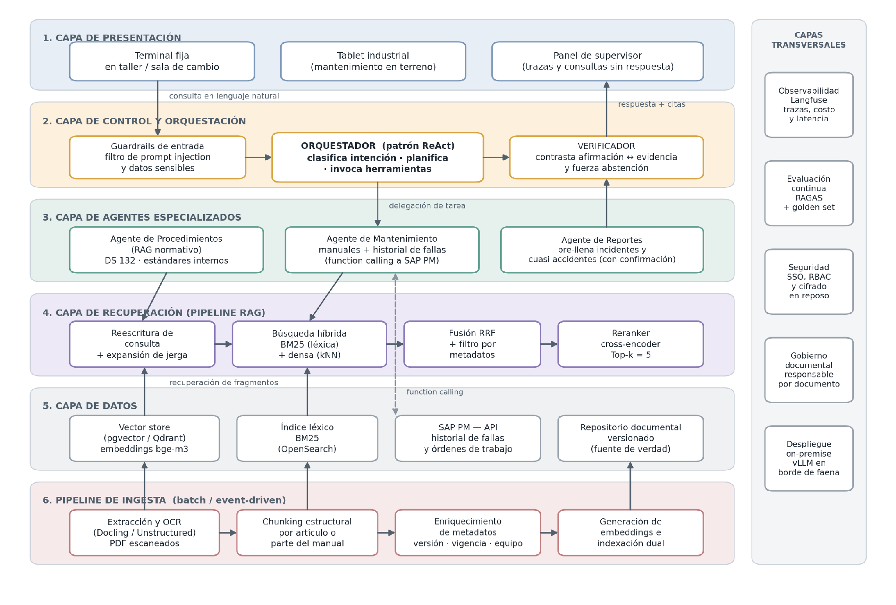
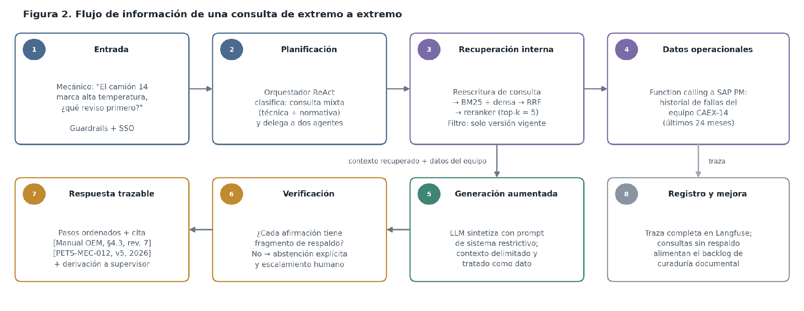

# Asistente de Faena — LLM + RAG + agentes

Prototipo académico para **ISY0101 Ingeniería de Soluciones con IA** (Evaluación Parcial N°1).
Caso: **Codelco, División Chuquicamata**. La documentación de seguridad y mantenimiento existe, pero cuesta encontrarla a tiempo.

El asistente responde consultas en lenguaje natural sobre procedimientos (PETS), normativa (DS 132), manuales de fabricantes en inglés e historial de fallas (SAP PM), bajo tres reglas:

1. **Toda respuesta cita su fuente**: `[documento | sección | revisión | vigencia]`.
2. **Se abstiene cuando no tiene respaldo** y deriva a una persona.
3. **La decisión queda en manos de una persona**: el asistente no autoriza intervenciones.

> ⚠️ El corpus, los usuarios y la base de SAP PM son **simulados**. Ningún documento es real ni pertenece a Codelco.

---

## Ejecución rápida

Requisitos: Python 3.10 o superior. Ollama es opcional, pero recomendado.

```powershell
# 1. Entorno e instalación
python -m venv .venv
.venv\Scripts\activate
pip install -r requirements.txt
pip install -e .

# 2. (Opcional, recomendado) modelos locales con Ollama
ollama pull bge-m3          # embeddings multilingües (~1,2 GB)
ollama pull qwen3.5:0.8b    # generador pequeño; puede reemplazarse por uno mayor

# 3. Construir el índice (se hace solo la primera vez que se consulta)
python -m asistente.ingesta

# 4. Usar el asistente
streamlit run app.py                                     # interfaz web (demo)
python -m asistente.cli --detalle                        # chat por terminal
python -m asistente.cli --pregunta "El camión 14 marca alta temperatura. ¿Qué reviso primero?" --detalle

# 5. Pruebas y evaluación
pytest -v                            # pruebas automatizadas
python eval/evaluar.py --offline     # métricas sobre el conjunto dorado (sin LLM)
python eval/evaluar.py               # métricas con el LLM local
python eval/evaluar_langsmith.py --local --offline   # tabla de métricas por respuesta (no envía nada)

# 6. (Opcional) Observabilidad y evaluación con LangSmith — ver la sección "LangSmith"
$env:LANGSMITH_TRACING = "true"
$env:LANGSMITH_API_KEY = "lsv2_..."
$env:LANGSMITH_PROJECT = "asistente-faena"
streamlit run app.py                               # cada consulta queda trazada con sus métricas
python eval/evaluar_langsmith.py --offline         # experimento sobre el conjunto dorado
```

> **Para la demo en un equipo sin GPU**, se recomienda el modo offline: `$env:MODO_LLM="offline"` antes de `streamlit run app.py` (respuestas en unos 5 s). Con el modelo pequeño en CPU cada respuesta tarda minutos y el verificador rechaza la mayoría de sus borradores (ver `evidencias/evaluacion_llm.txt` y CAMBIOS.md).

Sin Ollama, el sistema funciona igual en **modo offline**: usa un embedder de respaldo y un generador extractivo que responde con oraciones literales de los documentos.

### Variables de entorno

Se pueden definir en la terminal (`$env:MODO_LLM = "offline"`) o en un archivo **`.env`** en la raíz del proyecto: copia `.env.example` como `.env` y completa los valores. El `.env` está en `.gitignore`, así que la API key de LangSmith nunca se sube al repositorio; si una variable está en ambos lados, gana la de la terminal. Durante `pytest` el `.env` no se carga.

| Variable | Valor por defecto | Uso |
|---|---|---|
| `MODO_LLM` | `auto` | `ollama`, `offline` o `auto` (usa Ollama si el modelo está disponible) |
| `MODO_EMBEDDINGS` | `auto` | `ollama`, `hashing` o `auto` |
| `MODELO_GENERADOR` | `qwen3.5:0.8b` | Modelo de Ollama para generar |
| `MODELO_EMBEDDINGS` | `bge-m3` | Modelo de Ollama para embeddings |
| `UMBRAL_ABSTENCION` | `0.30` | Puntaje mínimo del mejor fragmento para responder |
| `VERIFICADOR_LLM` | (vacío) | `1` agrega el veredicto del LLM al verificador determinista |
| `LANGSMITH_TRACING` | (vacío) | `true` para enviar trazas a LangSmith (requiere también la API key) |
| `LANGSMITH_API_KEY` | (vacío) | Clave de LangSmith (*Settings → API Keys*) |
| `LANGSMITH_PROJECT` | `default` | Proyecto de LangSmith donde quedan las trazas |
| `LANGSMITH_ENDPOINT` | (SaaS) | URL de una instancia autoalojada o de la región EU |
| `LANGSMITH_DATASET` | `asistente-faena-golden` | Nombre del dataset para los experimentos |

Usuarios de prueba (SSO simulado): `tok-mecanico-mina`, `tok-supervisor` y `tok-contratista`.

---

## Arquitectura



Flujo de una consulta (Figura 2 del informe):



El grafo del orquestador está implementado en LangGraph ([src/asistente/grafo.py](src/asistente/grafo.py)):

```
entrada → reescritura → clasificación ─┬─> reporte (borrador; registra solo con confirmación)
                                       └─> recuperación ─[umbral + respondibilidad]─┬─> abstención
                                                                                    └─> generación → verificación ─┬─> respuesta
                                                                                                                   ├─> reintento extractivo
                                                                                                                   └─> abstención
```

### Cinco agentes

| Agente | Qué hace | Archivo |
|---|---|---|
| Orquestador | Clasifica la intención (procedimientos, mantenimiento, mixta o reporte), delega y controla los reintentos | `grafo.py`, `agentes.py` |
| Procedimientos | RAG normativo: PETS, DS 132, hojas de seguridad e incidentes | `agentes.py` |
| Mantenimiento | Manuales OEM y boletines, más el historial exacto de SAP PM por *function calling* | `agentes.py`, `herramientas.py` |
| Reportes | Pre-llena el reporte de incidente; registra solo si el usuario confirma (RF-05) | `agentes.py`, `herramientas.py` |
| Verificador | Revisa afirmación por afirmación: cita válida y contenido presente en el fragmento citado | `verificador.py` |

### Prototipo frente a producción

| Componente | Producción (informe) | Prototipo (este repositorio) |
|---|---|---|
| Orquestación | LangGraph | LangGraph ✔ |
| Generador | LLM abierto de 70B con vLLM on-premise | LLM pequeño local con Ollama, o generador extractivo |
| Embeddings | bge-m3 | bge-m3 vía Ollama ✔ (respaldo: n-gramas) |
| Índice léxico | OpenSearch (BM25) | `rank-bm25` en memoria |
| Índice vectorial | pgvector | matriz NumPy en disco |
| Reranker | bge-reranker-v2-m3 | Combinación de similitud semántica, cobertura de términos y prioridad |
| Herramientas | Servidor MCP sobre la API de SAP PM | Funciones con autorización + servidor MCP opcional (`mcp_servidor.py`) sobre SAP simulado |
| Extracción | Docling con OCR | Markdown con metadatos (corpus simulado) |
| Observabilidad | Langfuse | **LangSmith** (trazas del grafo, feedback con métricas, monitoreo) + trazas JSONL en `trazas/` + panel de supervisor |
| Evaluación | RAGAS con 250 preguntas | Métricas propias inspiradas en RAGAS con 26 preguntas, también como **experimentos en LangSmith** |

---

## Cómo se cumple cada requerimiento

| Requerimiento | Implementación | Prueba |
|---|---|---|
| RF-01 / RF-02 Consultas normativas y manuales en inglés | Recuperación híbrida y bilingüe; glosario ES→EN | `test_busqueda_bilingue_encuentra_manual_en_ingles` |
| RF-03 Historial por equipo | `consultar_historial` (datos exactos, no vectorizados) | `test_ejemplo_camion_14` |
| RF-04 Cita en cada respuesta | Plantilla de cita + verificador | `test_verificador_*` |
| RF-05 Reportes con confirmación | `registrar_reporte(confirmado=...)` | `test_reporte_no_se_registra_sin_confirmacion` |
| RF-06 Abstención y escalamiento | Umbral + respondibilidad + verificador | `test_se_abstiene_sin_respaldo` |
| RNF-04 Solo documentos vigentes | Filtro de metadatos antes de buscar | `test_nunca_usa_revisiones_superadas` |
| RNF-05 Permisos por rol | Autorización en la herramienta, no en el prompt | `test_contratista_no_ve_historial`, `test_mecanico_no_ve_equipos_de_otra_area` |
| RNF-06 Trazabilidad | `trazas.py` + panel de supervisor + LangSmith (`observabilidad.py`) | `test_metricas_quedan_en_la_traza_local`, `test_el_token_no_entra_al_estado_del_grafo` |
| OWASP LLM01 Inyección | Saneamiento al indexar + guardrail de entrada + regla 7 del prompt | `test_no_obedece_orden_escondida` |

---

## Métricas por respuesta

Cada respuesta trae sus métricas en `resultado["metricas"]`. Se muestran en la interfaz (debajo de cada respuesta y como promedio en el panel de supervisor), en la CLI con `--detalle`, quedan en la traza JSONL y, si LangSmith está activo, se envían como *feedback* de la traza. Se calculan en `src/asistente/metricas.py`.

**Rendimiento** (medido con `time.perf_counter` en cada nodo del grafo)

| Métrica | Qué mide |
|---|---|
| Tiempo total | Desde que entra la pregunta hasta que sale la respuesta |
| Recuperación | Filtro de vigencia, BM25, búsqueda densa, fusión RRF, reranking y consulta a SAP PM |
| Generación | Suma de los intentos de generación (LLM o extractivo). Vacío si se abstuvo antes de generar |
| Docs recuperados | Fragmentos que llegan al generador tras el reranking (top-k), y de cuántos documentos distintos |

**Calidad** (inspiradas en RAGAS, Es et al., 2024; deterministas, sin LLM juez)

| Métrica | Cómo se calcula |
|---|---|
| Fidelidad | Fracción de afirmaciones respaldadas por el fragmento que citan (la calcula el Verificador) |
| Relevancia | Fracción de los conceptos núcleo de la pregunta que la respuesta aborda, con el glosario español-inglés. Con bge-m3 se complementa con similitud semántica para reconocer paráfrasis |
| Precisión del contexto | Si los fragmentos útiles quedaron arriba en el ranking: promedio de precision@k en las posiciones útiles (fórmula de RAGAS). En producción un fragmento es útil si la respuesta lo cita; en la evaluación, si su documento es uno de los esperados |

Las métricas de calidad solo se calculan sobre respuestas entregadas: si el asistente se abstiene, valen "no aplica".

```powershell
python -m asistente.cli --pregunta "El camión 14 marca alta temperatura. ¿Qué reviso primero?" --detalle
python eval/evaluar_langsmith.py --local --offline     # tabla de las 26 preguntas en evidencias/
```

---

## LangSmith: observabilidad, monitoreo y evaluación

La integración está en `src/asistente/observabilidad.py` y es **opcional**: se activa solo con `LANGSMITH_TRACING=true` **y** `LANGSMITH_API_KEY`. Sin ellas, o sin el paquete `langsmith`, el asistente funciona igual y no sale ningún dato del equipo.

### 1. Activar

1. Crea una cuenta en https://smith.langchain.com y una API key en *Settings → API Keys*.
2. En la terminal (PowerShell):

```powershell
$env:LANGSMITH_TRACING = "true"
$env:LANGSMITH_API_KEY = "lsv2_..."
$env:LANGSMITH_PROJECT = "asistente-faena"
streamlit run app.py
```

O, para no escribirlas cada vez, con un archivo `.env` (ver *Variables de entorno*):

```powershell
Copy-Item .env.example .env    # luego pega tu API key en .env
streamlit run app.py
```

La barra lateral muestra `LangSmith: activo · proyecto 'asistente-faena'` y cada respuesta muestra el id de su traza.

### 2. Observabilidad: qué queda en cada traza

| Paso | Tipo en LangSmith | Qué se ve |
|---|---|---|
| `asistente_faena` | chain (raíz) | Pregunta, respuesta, citas, veredicto y métricas |
| Grafo de LangGraph | chain | Cada nodo (entrada, reescritura, clasificación, recuperación, generación, verificación) con su latencia |
| `recuperacion_hibrida` | retriever | Los fragmentos recuperados como documentos, con documento, sección, revisión y puntaje |
| `sap_pm.consultar_historial` | tool | Equipo consultado y órdenes de trabajo devueltas |
| `ollama_chat` | llm | Mensajes enviados al modelo y su respuesta (solo con LLM) |
| `verificador` | chain | Veredicto, fidelidad y detalle por afirmación |

Las siete métricas de la respuesta (`fidelidad`, `relevancia`, `precision_contexto`, `tiempo_total_s`, `tiempo_recuperacion_s`, `tiempo_generacion_s`, `docs_recuperados`) y `abstencion` se adjuntan como *feedback* de la traza.

### 3. Monitoreo

En el proyecto, la pestaña **Monitor** grafica automáticamente la cantidad de trazas, la latencia (p50/p99), los errores y el promedio de cada *feedback* en el tiempo. Para un tablero propio: *Dashboards → New dashboard* y agrega un gráfico por métrica (*Feedback → fidelidad*, *relevancia*, *precision_contexto*, *tiempo_total_s*…), filtrando por el proyecto `asistente-faena`.

### 4. Evaluación: experimentos sobre el conjunto dorado

```powershell
python eval/evaluar_langsmith.py --offline     # sube el dataset (la primera vez) y crea un experimento
python eval/evaluar_langsmith.py               # mismo experimento con el LLM local, para comparar
```

El script sube `eval/golden_set.jsonl` como dataset `asistente-faena-golden` y califica cada respuesta con los mismos evaluadores de la evaluación local (`eval/evaluadores.py`): fidelidad, relevancia, precisión del contexto, context recall@5, abstención correcta, resistencia a manipulación, solo vigentes, OT correcta y los tiempos. En *Datasets & Experiments* se pueden comparar experimentos lado a lado (offline frente a LLM, distintos umbrales o modelos).

### 5. Privacidad (RNF-02)

- **El token SSO y la memoria de la sesión no entran al estado del grafo**, que LangSmith registra completo: el estado solo lleva un id de sesión opaco (prueba: `test_el_token_no_entra_al_estado_del_grafo`). Las herramientas tampoco envían el token.
- El usuario se registra con su seudónimo, igual que en las trazas locales.
- Con `LANGSMITH_TRACING=true` pero sin API key no se intenta enviar nada.
- LangSmith en la nube recibe el texto de las consultas y de los fragmentos. Para el prototipo no hay problema porque el corpus es simulado; **con documentación real de Codelco** se debe usar una instancia autoalojada de LangSmith (`LANGSMITH_ENDPOINT`) u ocultar entradas y salidas (`LANGSMITH_HIDE_INPUTS=true`, `LANGSMITH_HIDE_OUTPUTS=true`).

---

## Estructura

```
├── app.py                    Interfaz web (Streamlit): chat + panel de supervisor
├── src/asistente/
│   ├── config.py             Parámetros (umbral, top-k, modelos)
│   ├── prompts.py            Prompts de sistema, plantilla y verificador (reglas R1–R8)
│   ├── ingesta.py            Chunking estructural, metadatos, indexación dual
│   ├── recuperacion.py       BM25 + densa → RRF → rerank → umbral
│   ├── contexto.py           Memoria de sesión y reescritura de la consulta
│   ├── agentes.py            Clasificación, generación, respondibilidad, reportes
│   ├── verificador.py        Verificación afirmación por afirmación
│   ├── herramientas.py       SAP PM y reportes con autorización por token
│   ├── guardrails.py         Inyección de prompt y datos personales
│   ├── grafo.py              Orquestador en LangGraph
│   ├── trazas.py             Trazabilidad local (JSONL)
│   ├── metricas.py           Métricas de rendimiento y calidad de cada respuesta
│   ├── observabilidad.py     LangSmith: trazas, feedback y contexto de privacidad
│   ├── llm.py / embeddings.py
│   ├── mcp_servidor.py       Servidor MCP opcional
│   └── cli.py                Chat por terminal
├── data/corpus/interna|externa   Corpus simulado (con metadatos YAML)
├── data/sap_pm_mock.json         SAP PM simulado
├── data/usuarios.json            Usuarios y roles simulados
├── eval/                         Conjunto dorado, evaluadores, evaluación local y en LangSmith
├── tests/                        Pruebas automatizadas
├── evidencias/                   Resultados de pruebas y evaluación
├── docs/                         Diagramas y bocetos
├── informe/                      Informe técnico
├── CAMBIOS.md                    Registro de cambios y errores corregidos
└── presentacion/                 Presentación de la defensa
```

## Resultados

Ver [evidencias/](evidencias/). Se actualizan al ejecutar `pytest` y `eval/evaluar.py`.

## Limitaciones

- Corpus reducido y simulado; el umbral de abstención está calibrado sobre él y debe recalibrarse con el corpus real.
- El generador pequeño que corre en un equipo con 6 GB de RAM traduce y redacta peor que un modelo de 70B. Por eso el verificador y el reintento extractivo son obligatorios.
- La clasificación de intención y la reescritura de consultas son por reglas (auditables); en producción pueden apoyarse en un LLM ligero.
- El verificador determinista mide respaldo léxico o semántico, no la verdad del contenido.
- La relevancia y la precisión del contexto son deterministas (sin LLM juez). En modo offline la relevancia es solo léxica y subestima las paráfrasis; con bge-m3 se complementa con similitud semántica.

## Uso de IA en el desarrollo

Declarado según https://bibliotecas.duoc.cl/ia (detalle en el Anexo A del informe):

- **Herramienta:** Claude Code, con el modelo Claude Opus 5.5 (Anthropic, 2026).
- **Código:** el equipo desarrolló el prototipo en conjunto con la herramienta, usada como apoyo para programar, ejecutar las pruebas automatizadas y la evaluación, y detectar y corregir fallas lógicas. El equipo revisó todo el código junto con la herramienta e hizo sus propios cambios.
- **Informe:** revisión de forma frente a la pauta (redacción, citas APA, enlace del repositorio). El análisis, las justificaciones técnicas, las conclusiones y las reflexiones individuales son del equipo.
- **Validación:** pruebas automatizadas y evaluación en [evidencias/](evidencias/); cambios y errores corregidos en [CAMBIOS.md](CAMBIOS.md).
